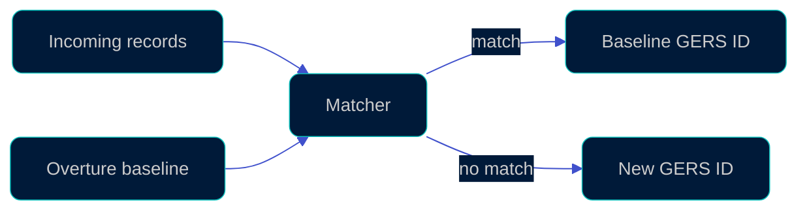

[](https://github.com/OvertureMaps/matchers/actions/workflows/test_python.yml)
[](https://github.com/OvertureMaps/matchers/actions/workflows/lint.yml)
[](../.python-version)
[](../packages/overture_matchers/pyproject.toml)
[](https://docs.astral.sh/uv/)
[](https://docs.astral.sh/ruff/)
[](../LICENSE)

Python matchers for conflating Overture Maps data: places, divisions and addresses. A matcher compares incoming records against the Overture baseline and assigns each one a GERS ID: the matched baseline record's ID, or a new ID when nothing matches.



Each matcher runs as a PySpark job on AWS Glue 5 (Spark 3.5, Python 3.11). This repo is a port of Overture's Scala matchers, and the package is pre-alpha while the port is in progress. The plan and progress are tracked in [OvertureMaps/matchers#1](https://github.com/OvertureMaps/matchers/issues/1).

## Packages

| Package | Description | PyPI |
| --- | --- | --- |
| [overture_matchers](../packages/overture_matchers) | The places, divisions and addresses matchers. | [](https://pypi.org/project/overture-matchers/) |

Each directory under [packages/](../packages) with a `pyproject.toml` and a `tests/` directory is one package, versioned and published to PyPI on its own.

## Design and parity

| Path | What it holds |
| --- | --- |
| [python-migration.md](python-migration.md) | The design for the port: the Scala system in brief, the target structure, library swaps and sequencing. |
| [parity/](../parity) | A harness that compares two matcher runs on the same input and prints where they differ. |

## Releases

Merging to `main` releases any package whose changes warrant a version bump. The PR title's [Conventional Commits](https://www.conventionalcommits.org/) type sets the bump (`feat!:` major, `feat:` minor, any other type patch), and the release is tagged `<package_dir>-v<version>`. See [PACKAGE_VERSIONING.md](PACKAGE_VERSIONING.md) for the flow and the one-time PyPI setup a new package needs.

## Contributing

See [CONTRIBUTING.md](../.github/CONTRIBUTING.md) for development setup, tests and lint.

## Maintainers

This repository uses `MAINTAINERS.md` files to track ownership for [LFX Insights](https://insights.linuxfoundation.org/docs/introduction/maintainers/) ingestion. LFX scans the full repository tree, so these files can live anywhere.

To add a `MAINTAINERS.md` for a module or package, create it in the relevant directory using this format:

```markdown
# MAINTAINERS

| Name     | GitHub Username | Role            | Affiliation |
| -------- | --------------- | --------------- | ----------- |
| Jane Doe | @janedoe        | Lead Maintainer | Org         |
```

## License

[MIT](../LICENSE)
