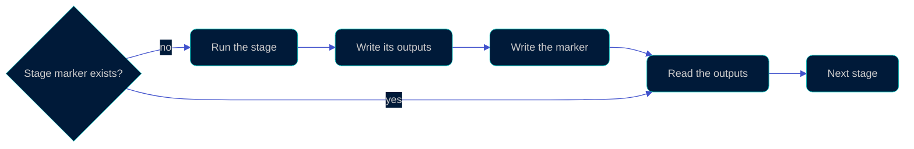

# How reruns work

A matching run is long, so a failed run resumes instead of starting over. Rerunning a job on the same run folder repeats only the stages that did not finish.

## Stage markers

Each stage writes its outputs to the run folder, then writes a marker. On a rerun, a stage with a marker is skipped, and its outputs are read back from the folder instead.

The marker is written only after all of the stage's outputs. A stage interrupted partway has no marker, so it runs again and overwrites its partial outputs.

A stage always hands the next one a read of its outputs from the folder, whether it ran or was skipped. A resumed run therefore sees the same data as an uninterrupted one.

Each feature type has its own marker, so a job that matches several feature types in one folder resumes each of them independently.

## Changed params

A skipped stage keeps the outputs it produced with the params of the earlier run. Mixing those with stages run under different params would give a result no single set of params describes.

> [!WARNING]
> A rerun with changed params fails once any stage has finished. Start a new run folder instead.

The check compares the params against the `config.json` in the run folder. Before any stage finishes, nothing depends on the old params, so a new `config.json` replaces the old one and a retry with corrected params works in the same folder.

The folder layout and the params are listed in the [run reference](run-reference.md).