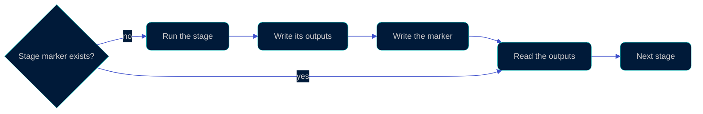

# How reruns work

Matching runs are long, so failed runs resume instead of starting over. Reruns on the same run folder repeat only the unfinished stages.

## Stage markers

Each stage writes its outputs to the run folder, then writes a marker. Reruns skip the marked stages and read those stages' outputs back from the folder.

Each marker is written only after all of the stage's outputs. Interrupted stages lack markers, so they rerun and overwrite their partial outputs.

Each stage passes its outputs to the next stage, whether the stage ran or was skipped. Resumed runs therefore see the same data as uninterrupted runs.

Each feature type has its own marker. Jobs can match several feature types in one folder, and each feature type resumes independently.

## Changed params

> [!WARNING]
> Reruns with changed params fail once the first stage has finished. Finished stages keep their outputs, so the rerun would combine those outputs with stages run under the new params, and the results would match neither set of params. Start a new run folder instead.

The check compares the params against `config.json` in the run folder. Before the first stage finishes, nothing depends on the old params. The new `config.json` then replaces the old file, so corrected params work in the same folder.

The folder layout and the params are listed in the [run reference](run-reference.md).