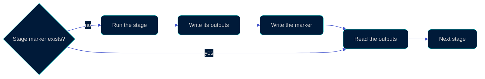

# Running a matcher

Every job takes the same params and writes the same run folder layout. The commands that start a run are in the [package README](../README.md#run).

## Job params

Params keep the Scala matchers' argument names, so an argument set from a Scala run works unchanged. Params outside this table are ignored.

| Param | Required | Meaning |
| --- | --- | --- |
| `outputPath` | Yes | The run folder. Every output, the stage markers and `config.json` sit inside it. |
| `input` | Yes | Incoming records, as a map of feature type to one parquet path or a list of them. A dict or a JSON string. |
| `baseline` | Yes | Baseline records, in the same shape as `input`. |
| `provider` | Yes | The data provider of the incoming records. |
| `matchHistory` | No | Whether candidates with history matches skip scoring. Defaults to `true`. Accepts a boolean or the strings `true` and `false`. |
| `modelJar` | Places only | The `places-matcher-model` jar. |
| `embeddingsCacheTable` | No | Accepted and recorded in `config.json`. No stage reads it yet. |
| `previousMetricsPath` | No | Accepted and recorded in `config.json`. No stage reads it yet. |

An `s3://` path in `outputPath`, `input`, `baseline` or `previousMetricsPath` is rewritten to `s3a://`, which works on any Spark platform with hadoop-aws. A trailing slash on `outputPath` is dropped.

## Run folder

A run writes zstd parquet under `outputPath`, one folder per output and feature type:

```text
<outputPath>/
  config.json                                     the run's settings and the package version
  <output>/type=<feature_type>/                   one stage output
  _completed_stages/<stage>/type=<feature_type>   marker written after a stage's outputs
  checkpoints/                                    Spark checkpoint directory
```

The output folder names match the Scala matchers' layout. Each job's page lists its stages and their outputs.

## Reruns

A rerun on the same folder skips every stage that has a marker and reads that stage's outputs instead. A marker is written only after all of its stage's outputs, so an interrupted stage runs again. Each feature type has its own marker.



> [!WARNING]
> A rerun with changed params fails once any stage has finished, because the finished stages ran with the old params. Start a new run folder instead.

Before any stage finishes, a new `config.json` replaces the old one, so a retry with corrected params works in the same folder.